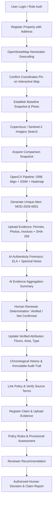

# PropertyWatch AI 🛰️

**A full-stack property-monitoring and insurance claim-assistance application with human-controlled review and auditable records.**

[](https://fastapi.tiangolo.com)
[](https://react.dev)
[](https://opencv.org)
[](https://sqlite.org)
[]()

---

## 1. Executive Summary & Operational Boundaries

Property information recorded when a property is registered or when an insurance policy is initially issued often becomes outdated when owners modify their structures (e.g. adding an extra floor, extending a building footprint, installing rooftop solar panels, constructing outbuildings, or building a swimming pool). 

**PropertyWatch AI** solves this through an independent, centralized property intelligence platform combining:
- **OpenStreetMap Nominatim Geocoding** for precise address-to-coordinate mapping.
- **Copernicus Data Space Ecosystem / Sentinel-2 Multispectral Feeds** for optical earth observation passes.
- **OpenCV Computer Vision Differencing** using ORB keypoint alignment, CLAHE equalization, Structural Similarity (SSIM), contour segmentation, and differential heatmaps.
- **Collision-Resistant Modification Alerts** (`MOD-2026-0001`).
- **Cryptographic Evidence Verification** storing files with SHA-256 anti-tamper hashes.
- **AI Image Authenticity Forensics** evaluating Error Level Analysis (ELA), spectral compression variance, and generative AI metadata markers.
- **Human Verification Determination Queue** where authorized reviewers review corroborating permits and commit updates.
- **Chronological Property Record Maintenance** preserving immutable baseline snapshots while updating verified attributes.
- **Auditable Dossier Generation** with multi-page branded PDF reports.
- **Policy and claim assistance** with versioned terms, configurable policy rules, owner evidence, provisional calculations, and separately recorded recommendations and authorized decisions.
- **Private uploaded-file storage** with authenticated download routes for claim and policy documents.
- **Private baseline photographs** stored outside public imagery mounts and served only through property-authorized API routes.

Building-change and rooftop-object ML predictions are **not available** until suitable trained weights are configured. The existing OpenCV image-comparison pipeline remains available as a visual difference indicator and does not infer cause or event timing.

> [!IMPORTANT]
> **Project Boundary Notice:** PropertyWatch AI does not integrate Guidewire PolicyCenter or any other insurance platform. It supports claim registration, evidence review, provisional calculations, reviewer recommendations, and explicit authorized decisions. AI and rules never make final claim decisions. A satellite difference or model score is not proof of a modification, damage date, cause, fraud, or coverage.

---

## 2. Technology Stack

### Frontend
- **Framework:** React 19 + Vite 8
- **Routing:** React Router DOM v7
- **Styling:** Custom Enterprise Dark Glassmorphism Design System (CSS variables, backdrop blur, modern typography)
- **Charts:** Recharts (Area charts for alert trends, Bar charts for categories breakdown)
- **Icons:** Lucide React
- **Geographic Mapping:** Leaflet with OpenStreetMap tiles

### Backend
- **Framework:** Python 3.13 + FastAPI
- **Data Validation:** Pydantic v2
- **ORM & Database:** SQLAlchemy 2.0 with persistent SQLite
- **Security:** Bcrypt password hashing + PyJWT Bearer Authentication (Role-Based Access Control)
- **Computer Vision:** OpenCV (`opencv-python-headless`), Pillow (`PIL`), NumPy
- **Forensics:** Error Level Analysis (ELA) + JPEG quantization variance + EXIF metadata inspection
- **Document & PDF Compilation:** ReportLab 5.1 (branded vectors, tables, side-by-side satellite graphics)
- **HTTP Clients:** Requests & HTTPX

---

## 3. Pre-Seeded Demo Accounts

The database comes pre-seeded with three realistic accounts representing each distinct operational role:

| Role | Email Address | Password | Capabilities |
| :--- | :--- | :--- | :--- |
| **Administrator** | `admin@propertywatch.ai` | `AdminPass123!` | Full control, property registration, system settings, mode toggling |
| **Reviewer** | `reviewer@propertywatch.ai` | `ReviewerPass123!` | Access Reviewer Workspace, review evidence, commit determinations |
| **Property Manager** | `manager@propertywatch.ai` | `ManagerPass123!` | View properties, upload baseline photos, submit permits & invoices |

*Note: The login page includes 1-click credential selector buttons for effortless testing.*

---

## 4. End-to-End Workflow Architecture



### Three Distinct Operational States:
1. **Visual Difference Detected:** Raw pixel variance between optical snapshots (can be caused by sun angle, shadows, or seasonal grass).
2. **Possible visual change:** OpenCV image comparison can identify pixel differences; no trained building-change model is configured.
3. **Human-reviewed finding:** An authorized reviewer records a determination using the available imagery, evidence, and limitations.

---

## 5. Quick Start Instructions (Windows)

### Prerequisites
- **Python 3.10+** (Tested on Python 3.13)
- **Node.js v18+** (Tested on Node v22.16)
- **npm v9+**

### Method A: One-Click Launch (Batch Files)

1. **Start Backend Server:**
   Double-click `run_backend.bat` (or run in cmd):
   ```cmd
   .\run_backend.bat
   ```
   *This automatically creates the virtual environment, installs dependencies, seeds demo records, and starts Uvicorn on `http://127.0.0.1:8000`.*

2. **Start Frontend Dev Server:**
   Double-click `run_frontend.bat` (or run in cmd):
   ```cmd
   .\run_frontend.bat
   ```
   *This installs node dependencies and launches the Vite client on `http://127.0.0.1:5173`.*

3. **Open Application in Browser:**
   Navigate to **[http://127.0.0.1:5173](http://127.0.0.1:5173)**.

---

### Method B: Manual Terminal Execution (PowerShell / VS Code)

#### 1. Backend Setup:
```powershell
# Navigate to backend
cd backend

# Create local configuration (do not commit .env)
Copy-Item .env.example .env
# Set a unique SECRET_KEY in .env before using outside local demo mode.

# Create and activate virtual environment
python -m venv venv
.\venv\Scripts\Activate.ps1

# Install requirements
pip install -r requirements.txt

# Start backend server
uvicorn app.main:app --host 127.0.0.1 --port 8000 --reload
```
The existing SQLite database is retained and schema initialization is non-destructive. Back up `backend\app\propertywatch.db` before making schema or data changes. Startup seeds demo records only when appropriate; it does not reset the database.

#### 2. Frontend Setup (in a second terminal):
```powershell
# Navigate to frontend
cd frontend

# Install node packages
npm install

# Start Vite development server
npx vite --port 5173 --host 127.0.0.1
```

---

## 6. Running the Automated Test Suite

The backend tests cover authentication, geocoding, image comparison, evidence integrity, policy terms, model availability boundaries, and property-policy-claim registration.
See [CHANGELOG.md](./CHANGELOG.md) for the most recent validation results and documented limitations.

Run tests using `run_tests.bat` or in the terminal:
```powershell
Set-Location backend
.\venv\Scripts\python.exe -m pytest -v
```
The latest verified test count is recorded in `CHANGELOG.md`; it is not a guarantee for later code changes.

---

## 7. Complete API Reference

FastAPI provides interactive OpenAPI Swagger documentation at **[http://127.0.0.1:8000/docs](http://127.0.0.1:8000/docs)**.

### Authentication & Profiles
- `POST /api/auth/login` — Authenticate and receive JWT Bearer token
- `GET /api/auth/me` — Retrieve profile of authenticated user

### Geocoding (OpenStreetMap Nominatim)
- `POST /api/geocode` — Geocode address to WGS84 coordinates (1 req/sec rate limit compliant & cached)

### Properties & Real Estate Dossiers
- `GET /api/properties` — List registered properties with filters, search, and alert counts
- `POST /api/properties` — Register a property following confirmed coordinates pin
- `GET /api/properties/{property_id}` — Get full property record with snapshots and alerts
- `PUT /api/properties/{property_id}` — Update property record (logs audit event)
- `GET /api/properties/{property_id}/history` — Chronological history timeline
- `POST /api/properties/{property_id}/baseline-photo` — Upload ground baseline photo
- `GET /api/properties/{property_id}/snapshots/{snapshot_id}/image` — Download a private owner-uploaded baseline photo after property access checks

### Satellite Feeds (Copernicus / Google Earth Engine)
- `GET /api/satellite/status` - which provider is usable
- `GET /api/monitoring/status`, `POST /api/monitoring/run`, `GET /api/monitoring/runs` - automated monitoring
- `POST /api/policies/{id}/clauses/extract`, `GET/PUT /api/policies/{id}/clauses[/{cid}]`, `POST /api/policies/{id}/clauses/apply` - clause review
- `POST /api/claims/{id}/settlement` - record payment
- `GET /api/satellite/search` — Search Sentinel-2 optical passes by coordinates and date range
- `POST /api/satellite/retrieve` — Acquire and store satellite tile (prevents duplicates)
- `GET /api/satellite/properties/{property_id}/snapshots` — List all snapshots for a property

### Computer Vision & Differencing
- `POST /api/analysis/compare` — Execute ORB alignment, CLAHE, SSIM, and generate heatmaps
- `GET /api/analysis/{analysis_id}` — Get analysis metrics, difference paths, and limitations

### Modification Alerts
- `GET /api/modifications` — List alerts with status and property filters
- `POST /api/modifications` — Create alert with collision-resistant ID (`MOD-2026-XXXX`)
- `GET /api/modifications/{modification_id}` — Get complete case dossier
- `PUT /api/modifications/{modification_id}` — Update alert status or assignment

### Evidence & Cryptographic Integrity
- `POST /api/modifications/{modification_id}/evidence` — Upload document/photo with SHA-256 hash
- `GET /api/modifications/{modification_id}/evidence` — List attached evidence items
- `GET /api/evidence/{evidence_id}/download` — Secure access-controlled download endpoint

### AI Authenticity Forensics
- `POST /api/evidence/{evidence_id}/analyze-authenticity` — Run ELA and spectral artifact detection
- `GET /api/evidence/{evidence_id}/authenticity` — Get forensic analysis history

### Human Reviewer Workspace
- `GET /api/reviews` — Get pending cases in review queue
- `POST /api/reviews/{modification_id}/decision` — Submit formal verification determination
- `GET /api/reviews/{modification_id}/summary` — Generate objective AI evidence summary

### Policies, Rules, and Claims
- `POST /api/policies` — Link a policy without supplying assumed limits, deductibles, exclusions, or endorsements
- `POST /api/policies/{policy_id}/document` — Store a private policy document and version its hash/reference
- `POST /api/policies/{policy_id}/verify-terms` — Record reviewer-verified terms
- `PUT /api/policies/rules/{rule_id}` — Configure or deactivate a rule (administrator only)
- `POST /api/policies/{policy_id}/evaluate-rules` — Record rule outcomes and execution inputs
- `POST /api/claims` — Register a claim against its property's linked policy
- `POST /api/claims/{claim_id}/evidence` — Upload private, hashed, duplicate-checked claim evidence
- `POST /api/claims/{claim_id}/damage-assessment` — Record human findings separately from optional model output
- `POST /api/claims/{claim_id}/provisional-calculation` — Calculate from verified policy limits and deductibles
- `POST /api/claims/{claim_id}/recommendation` — Save a review recommendation
- `POST /api/claims/{claim_id}/decision` — Save a versioned decision for authorized decision-makers only
- `GET /api/reports/claims/{claim_id}` — Generate a claim dossier

The React **Insurance Claims** page provides claim registration, evidence submission, reviewer assessment/recommendation, authorized decisions, and reports. Policy linking and term verification are available in the property's detail view.

### Reporting & Auditing
- `GET /api/reports/modifications/{modification_id}` — Generate & download official PDF dossier
- `GET /api/reports/properties/{property_id}` — Export comprehensive property dossier
- `GET /api/audit-logs` — Immutable audit trail query
- `GET /api/dashboard/metrics` — Real-time database metrics for dashboard analytics
- `GET /api/settings/status` — Operational health of all 5 system subsystems
- `POST /api/settings/toggle-demo` — Switch between Demo and Live mode

---

## 8. Demo Mode vs Live Mode

| | DEMO_MODE=true | DEMO_MODE=false (live) |
| --- | --- | --- |
| Users / properties | Seeded Indian sample records (flagged `is_demo`) | None. Optionally bootstrap one admin via `BOOTSTRAP_ADMIN_EMAIL/PASSWORD` |
| Satellite images | Synthetic tiles, watermarked **DEMO SYNTHETIC**, `data_origin=DEMO_SYNTHETIC` | Real Sentinel-2 only (`data_origin=SATELLITE_LIVE`); HTTP 503 if no provider is configured |
| Geocoding | Nominatim; offline Indian city-centre fallback labelled DEMO | Nominatim only; 404/502 on failure (no invented coordinates) |
| Scheduled monitoring | Skipped unless `MONITORING_RUN_IN_DEMO=true` | Runs every `MONITORING_INTERVAL_HOURS` |

### Live satellite setup
1. **Copernicus Data Space (recommended, free):** create an account at dataspace.copernicus.eu, then Dashboard > OAuth clients > create client. Put the id/secret in `COPERNICUS_CLIENT_ID` / `COPERNICUS_CLIENT_SECRET`. The app authenticates with OAuth2 client-credentials, searches the Sentinel Hub Catalog (`sentinel-2-l2a`, cloud filter) and downloads a true-colour tile with the Process API.
2. **Google Earth Engine (optional):** `pip install earthengine-api`, register a Cloud project for Earth Engine, create a service account + JSON key, and set `GEE_PROJECT_ID`, `GEE_SERVICE_ACCOUNT_EMAIL`, `GEE_SERVICE_ACCOUNT_KEY`.
3. `GET /api/settings/status?probe=true` (Settings page) tests authentication for real.

**Resolution limit:** Sentinel-2 is 10 m/pixel. It shows footprint-scale change only; it cannot show rooftop solar panels, small extensions or interior changes. For those you need sub-metre imagery (commercial providers, drone/aerial surveys) uploaded as snapshots.

### Trained AI models (not bundled)
No weights ship with this repository, so both detectors report `UNAVAILABLE` until you supply them.
* **Building change** - ONNX export of a change-detection network trained on LEVIR-CD (FC-Siam, BIT, ChangeFormer...). Two inputs `[1,3,H,W]` (or one 6-channel input), output change logits `[1,1,H,W]` or `[1,2,H,W]`. Set `LEVIR_CD_MODEL_PATH` or place `models/levir_cd.onnx`.
* **Rooftop objects** - Ultralytics YOLO ONNX export, class names in `ROOFTOP_MODEL_CLASSES`. Set `ROOFTOP_MODEL_PATH` or place `models/rooftop_yolo.onnx`.
Availability is verified by actually loading the file with ONNX Runtime at startup and on every call. These models are trained on <=1 m imagery, so on 10 m Sentinel-2 tiles their output is of limited value. OpenCV differencing remains the supporting analysis.

### Policy documents
`POST /api/policies/{id}/document` (PDF) extracts text (pypdf/pdfplumber; OCR if tesseract is installed) and identifies clauses (sum insured, deductible/excess, insured perils, exclusions, sub-limits, usage, conditions, endorsements; INR, lakh/crore aware). Clauses start as **Extracted**; a reviewer verifies/corrects each (`PUT /api/policies/{id}/clauses/{cid}`) and then applies them (`POST .../clauses/apply`), which creates a new policy version. Rules only use verified terms.

### Claim workflow
submission -> evidence -> review (`Under Evaluation`) -> damage assessment -> policy-rule evaluation -> provisional payout -> recommendation -> decision (decision-maker/admin only; approval needs a calculation + recommendation and cannot exceed the payout; denial needs cited clauses and verified terms) -> settlement (`POST /api/claims/{id}/settlement`: NEFT/RTGS/UPI/IMPS/cheque + reference). Reviewers cannot set outcome statuses directly.

### Automated monitoring
APScheduler runs `monitoring_service.run_monitoring_cycle` every `MONITORING_INTERVAL_HOURS`: find newer cloud-filtered passes, download, compare with the previous snapshot (OpenCV), and if the change score >= `MONITORING_ALERT_CHANGE_SCORE` create a `New` modification alert plus in-app notifications (owner, reviewers, admins) and optional SMTP e-mail. Manual trigger: `POST /api/monitoring/run`; history: `GET /api/monitoring/runs`.

## 9. Troubleshooting & FAQ

- **Database preservation:** The SQLite database is `backend\app\propertywatch.db`. Do not delete it to resolve setup problems. Back it up before upgrades; startup creates missing tables and applies only additive schema changes.
- **Port conflicts:** If port `8000` or `5173` is occupied on your system, adjust the `--port` flag in `run_backend.bat` or `run_frontend.bat`.
- **File Upload Limits:** Policy and claim documents support PDF, JPG, PNG, and WEBP. Modification evidence also supports TIFF. Uploads are limited to 25 MB and stored outside public static mounts.
- **Model availability:** see section 8; without weights the detectors return `UNAVAILABLE`.
- **Policy extraction:** extracted clauses are suggestions; a reviewer must verify them. Scanned PDFs need tesseract + poppler.
- **Demo credentials:** Pre-seeded accounts are for local demonstration only. Replace credentials and configure a unique `SECRET_KEY` before deployment.

---

*PropertyWatch AI — Independent Property Modification Intelligence & Auditable Record Management.*
